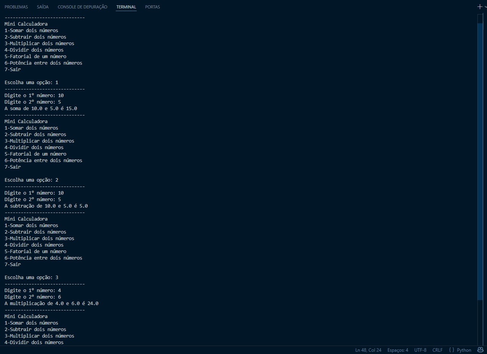
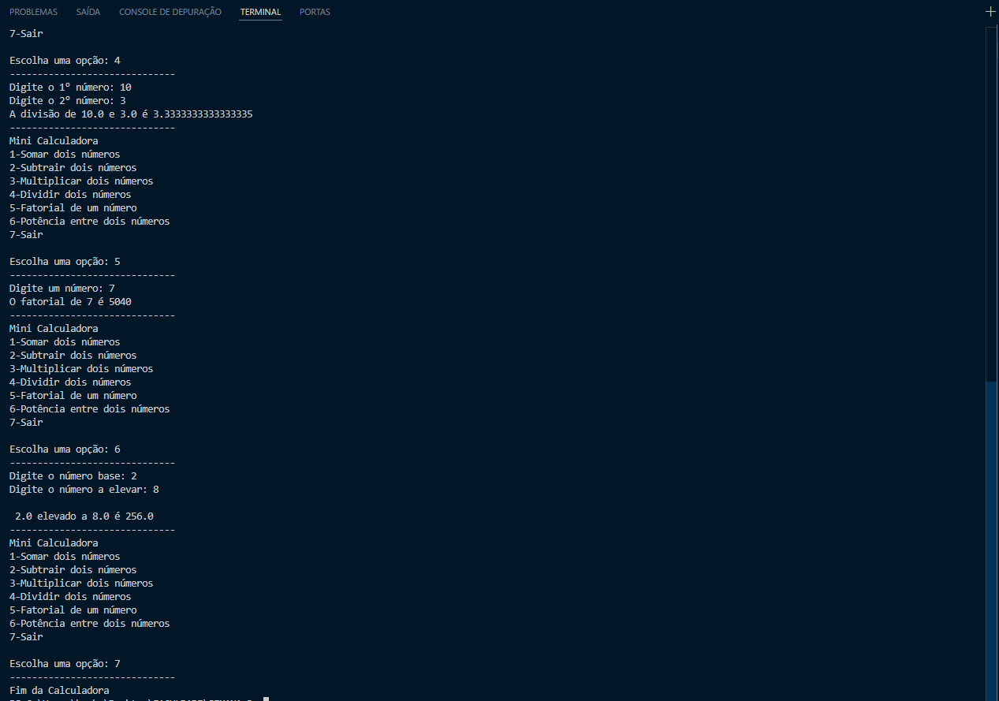

# Mini Calculadora em Python

Calculadora de terminal que usa um menu interativo para praticar condicionais, laços de repetição e tratamento de entradas.

## Como executar

Com Python 3 instalado, execute:

```bash
git clone https://github.com/herbertfariasss/calculadora-python-menu.git
cd calculadora-python-menu
python main.py
```

Escolha uma operação pelo número no menu. Use ponto para digitar valores decimais, como `2.5`. O fatorial aceita inteiros a partir de zero. Digite `7` para sair.

| Opção | Operação |
| --- | --- |
| 1 | Soma |
| 2 | Subtração |
| 3 | Multiplicação |
| 4 | Divisão |
| 5 | Fatorial |
| 6 | Potência |

## Capturas de tela




